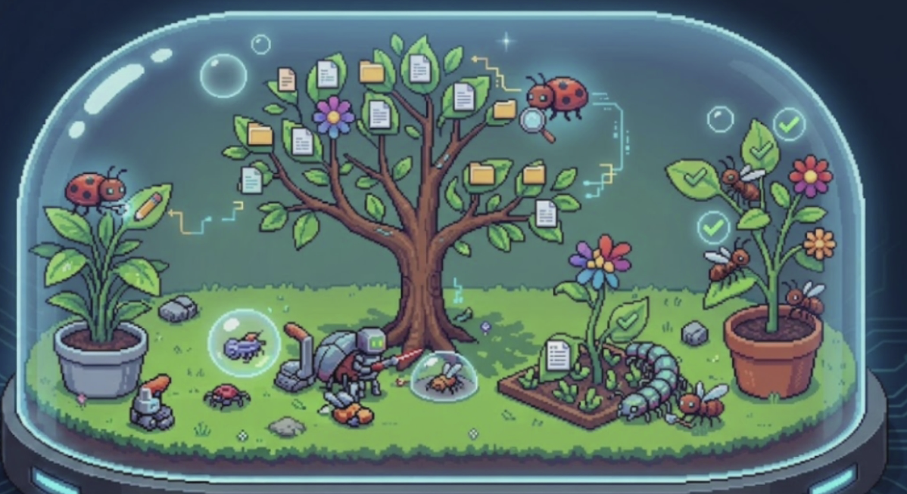

# Chill mode implementation plan

Status: implemented in `codex/chill-mode`, 12 October 2026. The original plan below remains the design reference. See [implementation and verification notes](../chill.md) and [ADR-011](../adr/ADR-011-chill-activity-and-skins.md).

Implementation refinements: a neutral native activity service and shared React interactions feed a small typed skin registry; Terrarium is the only production skin. Bounded snapshot polling reuses the existing authenticated bridge. Original retained vector artwork replaces the proposed pixel atlas after image generation reached the account limit. Stable file sockets and aggregation replace directory-tree reconstruction. Automated provider fixtures, renderer tests and Mac packaging are covered; physical Android testing and the long-run performance gates below remain release validation.

User refinement, 12 October: Chill is now observational with **project names as the only visible text, shown only when several projects are in sight; no title**. Focusing one project hides its name. Botanical palettes include richer greens, coral, gold, lilac and teal. Quiet icons replace the dashboard, scene labels and text inspection panels. Source navigation returns to normal screens for detailed work; preferences/history controls live in normal Settings. Project focus uses bounds-based camera framing so the whole plant remains inside the dome. This takes precedence over the text UI described in the original plan below.

**1. The experience we are building**

Chill replaces the main workspace interface with a living cyber terrarium that shows what ThingMaker's agents are actually doing. A glass dome holds a miniature garden: projects become plants, files become leaves and flowers, and agents become small cyber bugs tending them. It should feel like watching a beautiful little ecosystem while work carries on.

The reference establishes the composition, miniature scale, friendly bugs, vegetation, and luminous glass. Use a consistent, carefully finished pixel-art style with layered depth and soft environmental lighting. Keep the scene readable and restful when busy, and beautiful when nothing is running.



The first release includes all live desktop sessions, delegated workers, reported native subagents, file activity, recent file history, project focus, useful inspection, and a reliable return to the regular interface. The engine's execution behaviour remains independent of the display mode.

**2. Visual and interaction direction**

- A rounded glass dome with a subtle cyan rim, warm moss, terracotta pots, small stones, luminous fungi, and a deep blue dusk background. Suggested starting palette: midnight `#152437`, moss `#7DA66B`, cream `#F4E8C9`, peach `#E9AB87`, lavender `#AAA0CC`, and restrained mint `#94DFCF`.
- Vegetation provides most of the colour. Cyber details are tiny antenna lights, translucent wings, little tool satchels, and occasional circuit-like paths. Keep glows local and low intensity.
- Use a fixed, slightly elevated diorama camera with a few parallax layers. Project focus is a slow camera move into the same world. Avoid constant camera motion, screen shake, flashing effects, or rearranging the garden when activity changes.
- Trees and pots have stable identities and positions. Project size is a composition choice, not a claim about productivity, code quality, or task completion.
- Every bug needs a clear silhouette, expressive antennae, squash and stretch, a soft contact shadow, and several small idle variations. Avoid identical robots with different colours.
- An orchestrator can be a round ladybug with a satchel; coding workers small beetles; review workers bees with magnifiers; research workers moths; image workers iridescent butterflies. These are role defaults. Provider/model appears in inspection and a discreet optional badge; role and identity must remain understandable without colour.
- Illustrations have clean pixel edges at supported scales; shadows and glass lighting may be smooth. UI text remains crisp DOM text. Use a logical scene around 960×540, then fit or crop intentionally at the supported window sizes.
- Entry transition: approximately 400–600 ms, a soft dissolve into the garden. Exit restores the previous workspace/session/tab, sidebar preference, composer draft, and transcript position. Provide a persistent visible exit and Escape; if a drawer is open, Escape closes it first.
- Keep a quiet top strip: “Chill”, project filter, focus/overview, atmosphere settings, and “Back to work”. A small persistent attention area holds questions, failures, and blocked goals. Hover or keyboard focus reveals labels; selection opens a compact side drawer.
- Click a plant for project activity and sessions. Click a bug for its actual task, provider, model, status, elapsed time, evidence freshness, and source session. Click a leaf for path, operation, last activity, associated actors, and an existing file/diff/transcript navigation action.
- Pause/cancel/answer actions use existing application commands and confirmation behaviour. “Freeze animation” pauses presentation only and says so. Chill never changes execution or suppresses attention notifications.
- Ambient sound is optional and muted by default. Add it after the visual and performance gates; use bundled, licensed sounds with independent volume and mute controls.

**3. What the garden means**

| Real ThingMaker fact | Terrarium expression | Required interpretation |
|---|---|---|
| Workspace/project | Stable tree or potted plant with a name tag | One project identity; active worktrees appear as distinguishable grafts/pots, preserving their real workspace IDs |
| Directory represented by touched files | Branch or small cluster | Allocate incrementally; a new file does not rebuild the plant |
| Known file | Leaf or flower bud | Derived from evidenced activity, rather than loading every file in the repository |
| File read/search result with an explicit path | Bug inspects a leaf with a small lens; dew shimmer | A requested read is distinct from a successfully completed read |
| File edit/create in progress | Bug tends a bud | Pending action; no successful-change bloom yet |
| Successfully reported edit/create | Bud opens briefly, then settles into a leaf/flower | Tool success, not proof that the implementation is correct |
| Successfully reported deletion | Leaf gently folds into a small seed marker | File is labelled deleted; keep its recent record available |
| Running session without a known file | Bug works at a project bench | General reported work, without an invented file target |
| Delegation | A new bug leaves the parent's bench, with a brief dotted trail | One worker session is one bug, even when reused for multiple jobs |
| Shell/build/test | Bug operates a miniature project bench | Do not claim each file in the repository was touched |
| Verified milestone | One restrained blossom on a separate goal stem | Requires the engine's verified milestone state |
| Waiting on quota/dependency | Bug rests under a leaf beside a small hourglass | Show the reason/reset time when reported |
| Completion | Short contented wiggle, then rest or return home | Animation follows a real settled state |
| Failure or user action needed | Bug stops beside a warm amber lantern | Persistent text/action remains available; avoid alarming weather or damage |
| Stale/uncertain activity or disconnected remote | Bug rests; scene carries a clear freshness indicator | Do not keep showing busy work as though it is current |

Several bugs can visit the same file. Give them separate perches around one leaf. A bug with overlapping tool calls has one main pose and a concurrent-action count in inspection. Completed jobs do not create permanent duplicate bugs.

**4. File recency and garden density**

Use a continuous size/brightness curve, with these initial product defaults:

| Time since confirmed activity | Appearance |
|---|---|
| Active, selected, or pinned | Full readable size; active files never shrink away |
| 0–5 minutes | Full size, brief residual glow |
| 5–30 minutes | Gradually settle toward 80% scale |
| 30 minutes–2 hours | Gradually settle toward 55% scale |
| 2–24 hours | Small background foliage, around 25–35% scale |
| Beyond 24 hours | Fold into an inspectable directory cluster; retain pinned files |

Expose the retention window later as “Keep recent leaves for …”, default 24 hours. File size is visual recency, not the number of tokens spent. Repeated tool-update patches must not repeatedly brighten a leaf or count as new edits.

Start with at most 6 detailed project plants in overview, 24 individually rendered leaves per overview plant, 80 leaves in project focus, and 40 individually animated bugs. These are initial performance/composition budgets, to tune in the vertical slice. Additional projects live on adjacent garden pages; excess foliage clusters by directory; excess bugs gather in labelled colony clusters. Every active entity remains discoverable in the accessible list and inspector, and attention indicators remain visible regardless of paging.

Reserve leaf slots and project positions deterministically using stable IDs. Allocate new items into free slots; compact old clusters only during a quiet transition. Never repack the whole tree on every update. Preserve selections through aggregation and reveal the relevant cluster when navigating to an entity.

**5. Existing integration points and missing evidence**

The current repository already provides most runtime facts:

| Existing code | Use in Chill |
|---|---|
| `crates/thingmaker-supervisor/src/supervisor/events.rs` | Ordered session envelopes, tool updates, process/turn state, permissions, quota, and resynchronisation markers |
| `crates/thingmaker-supervisor/src/agents/events.rs` | Provider-neutral subagent names, ancestry fields, status, generation, task, and timestamps |
| `crates/thingmaker-supervisor/src/acp/updates.rs` | Tool patches, explicit file locations, raw structured inputs/results, and merge semantics |
| `crates/thingmaker-supervisor/src/delegation/jobs.rs` | Job status, worker session identity, retry time, warm reuse, and result |
| `apps/desktop/src-tauri/src/state.rs` | Registration and removal of live actors, including worker sessions |
| `apps/desktop/src/store.ts`, `projection.ts`, and `team.ts` | Existing session navigation, UI preferences, event projection, and worker correlation |
| `apps/desktop/src/App.tsx`, `TopBar.tsx`, `shortcuts.ts`, and `components/CommandPalette.tsx` | Enter/exit mode and application shell integration |
| `apps/desktop/src-tauri/src/remote/dispatch.rs` | Explicit command allowlist for a later phone release |

Important evidence gaps must be handled before the scene claims precise activity:

- Native subagent events are currently derived partly from `Agent`/`Task` and `collab:spawnAgent` tool lifecycles. A spawn tool completing may only confirm dispatch, rather than the child finishing. Audit provider fixtures and real lifecycle metadata before treating those statuses as authoritative.
- File tool events do not consistently identify their native child owner. Add ownership where the provider supplies it; otherwise attribute the action to the session/project and show the child at the project bench. A task description naming a file is not evidence of touching it.
- Shell commands and arbitrary MCP results do not reliably identify files. Prefer explicit provider locations, recognised structured tool fields, structured command actions, and successful file-change results. Unknown shapes remain general activity. Do not regex arbitrary prose into “confirmed edits”.
- Distinguish requested targets, successful accesses/changes, verified outcomes, and historical records. UI labels and animation must preserve these distinctions.

**6. Technical architecture**

Add a lightweight native activity projection, independent of the React transcript cache. It collects while Chill is off, so entering the garden immediately shows all live sessions and recent work without opening every transcript.

```text
Session actors + delegation + Big Thing records
    → native ActivityService: normalise, merge, deduplicate, correlate
    → compact activity snapshot + ordered delta stream
    → chillStore: live domain facts and selection
    → scene planner: stable plants, leaves, perches, and animation intents
    → Pixi renderer + React inspection/attention UI
```

Use PixiJS 8 with WebGL as the initial rendering preference, mounted inside a React `ChillView`. React owns navigation, controls, settings, text, and accessibility; Pixi owns sprites, depth ordering, lighting, and animation. Pin the exact library version after the compatibility spike. Its documented application lifecycle supports renderer selection and a private ticker; use those controls to own and stop the scene loop explicitly. See [PixiJS Application](https://pixijs.com/8.x/guides/components/application).

A 2D sprite scene with layered depth fits the reference and avoids the modelling, lighting, and camera complexity of a full 3D engine. Prototype in the actual packaged Tauri WKWebView, rather than assuming Vite/Chrome proves compatibility. Bundle assets locally. Verify the existing CSP supports the chosen renderer and shaders without broadening it speculatively. If rendering is unavailable, show a composed static garden and the same accessible live activity list.

Proposed new modules:

```text
crates/thingmaker-supervisor/src/activity/
  mod.rs            service, actor observation, revisioned snapshots/deltas
  model.rs          project, actor, file activity, provenance, freshness
  extract.rs        bounded, provider-aware structured path/action extraction
  reduce.rs         tool patch merging, identities, lifecycle and deduplication
crates/thingmaker-supervisor/src/storage/activity.rs
crates/thingmaker-supervisor/src/storage/schema/0020_activity.sql
apps/desktop/src-tauri/src/commands/activity.rs
apps/desktop/src/chill/
  ChillView.tsx, ChillInspector.tsx, ChillAttention.tsx, ChillSettings.tsx
  store.ts, selectors.ts, types.ts
  scene/layout.ts, scene/plan.ts, scene/paths.ts, scene/animation.ts
  render/Terrarium.ts, render/Plant.ts, render/Bug.ts, render/Leaf.ts
  assets/manifest.ts
apps/desktop/public/chill/   atlases, backgrounds, optional audio
```

Use the next available schema migration number when implementation starts. Add a short ADR for the shared read-only activity projection and renderer ownership. This feature introduces no model-visible tools and no new provider calls.

The data model must include:

- Project ID, actual workspace ID/root, optional source-project/worktree relation, and a stable visual seed.
- Actor identity scoped by provider/session/runtime child ID, parent relation, role, reported model, current job, lifecycle confidence, and freshness. Separate stable actor identity from attachment generation and job identity.
- File identity scoped to workspace and normalised path, display path, active actors/actions, operation, evidence source, last confirmed touch time, and optional deletion/rename state.
- Tool operation identity scoped by attachment generation and tool call ID. Apply partial-patch omission/null/replacement semantics before extracting facts. Count start and terminal transitions once, preserving multiple explicitly reported files.
- Global scene revision as a decimal string, plus per-attachment event cursors. Never convert sequence IDs to JavaScript floating-point numbers.

Resolve relative paths against the tool's reported cwd when present, otherwise the actor's actual root. Handle worktrees, Windows paths in protocol fixtures, renamed/deleted files, and aliases consistently. Canonicalise existing paths where appropriate; retain a lexical identity for files not created yet. Paths outside the workspace belong in an “External files” cluster and keep their actual provenance. Do not read file contents to build this view.

Persist compact per-file last-touch facts and relevant source identities; do not duplicate raw transcripts or tool outputs. Initial policy: keep at most 7 days of summaries, prune unpinned records, and cap at 5,000 file summaries per project using oldest inactive eviction. The 24-hour display window is independent of retention. Reuse UI preferences for layout, pins, and atmosphere. Add a clear-history action scoped to Chill metadata.

Register activity observers for every actor creation/removal path, including workers and Big Thing handoffs. Bootstrap each observer with a subscription/history barrier and cursor deduplication so early events are neither lost nor applied twice. The native service uses the same pattern for snapshot-plus-live subscriptions: revisioned snapshots, buffered deltas, and a fresh snapshot after lag.

Replay rebuilds current state without replaying celebratory animations. Historical events without trustworthy wall-clock timestamps have unknown recency; do not label them “just touched”. Persisted live states are never restored as running after restart without a current actor snapshot. Time-based animation uses a monotonic clock; recency uses recorded wall-clock activity with negative ages clamped.

**7. Animation and art production**

Separate domain state from animation state. The scene planner turns evidence transitions into short animation intents; the renderer interpolates them and cannot change job status. A completed tool can interrupt travel and settle the bug immediately. A running tool must not keep a completion queued behind a long decorative sequence.

Implement explicit poses for arrival, walking/flying, looking, tending, building/testing, reviewing, waiting, sleeping, celebration, and attention. Use bounded navigation paths between stable perches, gentle acceleration, depth-aware occlusion, and simple lane offsets for avoidance. A full physics engine or simulation AI is unnecessary. Bugs may blink, breathe, and adjust antennae while idle; task-specific work poses require actual activity.

Initial asset pack:

- One dome/environment with separate background, base, vegetation, shadow, rim, reflection, and foreground layers.
- Four project plant families with modular branch/perch sockets and consistent perspective.
- Five bug families, roughly 64–96 px source frames, with 4 directions and 6–8 core animation loops. Share locomotion/body animation with tool overlays where that improves consistency.
- File leaf/bud/flower variants, seed/deletion markers, tiny lenses/tools, lantern/hourglass markers, and restrained particles.
- A packed atlas manifest with pivots, socket coordinates, frame durations, hit regions, and stable names. Document palette, pixel scale, light direction, and export settings.

Create a full-quality hero composition before producing the entire pack. Check bugs at actual displayed size, including a minimum readable/hittable target. Inspect loop seams, alpha edges, shadows, sprite padding, texture bleed, and mixed scaling on Retina. Generated concept art may assist production, but every shipped sprite sheet needs frame and style QA. No runtime image generation is needed.

Environmental motion has a slow rhythm: occasional plant sway, rare drifting motes, tiny ripples of light. Cap simultaneous completion effects and merge bursts into one soft pulse. A very busy workload should look populated and purposeful, rather than frantic. Empty, idle, waiting, and error scenes each receive a deliberate visual composition.

**8. Performance, accessibility, and compatibility gates**

- Initial desktop target: p95 frame time at or below 16.7 ms at 1280×820 on a recorded Apple-silicon reference Mac, with 6 plants, 144 leaf sprites, and 40 bugs. Measure the packaged app while provider output streams. Tune the scene budgets if this target is missed.
- Economy setting: 30 fps, fewer particles/reflections, and a capped resolution. Stop rendering when the window is hidden/minimised or Chill is not mounted; native activity collection continues. On return, reconcile facts before animating.
- Lazy-load the renderer and art only when entering Chill. Cache reusable atlases, batch sprites, avoid whole-scene filters, and apply effects to small regions. These choices follow [PixiJS performance guidance](https://pixijs.com/8.x/guides/concepts/performance-tips).
- Keep per-frame positions and animation clocks outside the main Zustand store. Publish activity deltas at most 10–15 times/second, flushing important attention/lifecycle changes promptly. Do no filesystem scanning or transcript parsing on an animation frame.
- Target incremental memory below 150 MB after warm-up on the reference workload; verify a 30-minute steady workload and 50 enter/exit cycles show no growing observer, listener, ticker, or GPU-resource count. Treat these as proposed budgets to validate in the spike.
- Respect both ThingMaker's reduced-motion preference and the OS setting. Reduced motion removes travel, parallax, sway, and bursts; use static poses and restrained fades. Include a separate freeze-animation control.
- All controls and entities have keyboard and screen-reader equivalents through a live activity list, with restrained announcements. Status requires text/icon/pose, never colour alone. Screen-space hit targets remain usable when scene objects shrink. Attention is never dependent on hovering a bug.
- The desktop is the first release. Keep the data contract reusable for Android, but do not add remote commands until explicit allowlist, reconnect, touch, low-power, and WebView rendering checks pass. Phone support is a separate final milestone.

**9. Implementation sequence and acceptance checks**

Each milestone has a reviewable output and must meet its checks before the next dependent scope expands.

| Milestone | Work and dependency | Completion check |
|---|---|---|
| M1 — Art direction and rendering spike | Build one beautiful static diorama plus one animated bug inside Tauri. Compare idle/busy compositions, test Pixi, CSP, Retina, minimum window size, reduced motion, and asset loading. | Captures at actual window sizes; packaged Mac build renders correctly; preliminary frame/memory measurements; art guide and renderer decision recorded. |
| M2 — Reliable activity model | Add native service/contracts/storage/commands. Observe all actors, correlate jobs, audit native subagent lifecycle, extract structured file facts, and implement snapshot/replay/resync. Can begin after M1's renderer decision while assets are developed. | Captured Claude/Codex/Gemini fixtures prove accurate identities, file evidence, partial patches, worker reuse, unknown ownership, restart, and lag recovery. No provider calls are added. |
| M3 — Polished vertical slice | Connect one real project, one parent, two workers, files, recency, six core poses, tooltips/drawer, enter/exit, and persistent attention. Depends on M1+M2. | A real read → edit → test → success sequence matches the transcript; a failed edit creates no success bloom; quota waiting visibly rests; switching modes preserves draft/navigation and execution. |
| M4 — Whole garden | Add all live projects, native children, worktree grouping, stable placement, overview/focus, directory clusters, actor deduplication, paging, retained foliage, and shared-file perches. | Replay 20 projects / 200 actors / 2,000 file facts without layout thrashing; clustering preserves exact counts and inspectability; active/selected leaves stay visible. |
| M5 — Full art and motion pass | Replace provisional art; finish bug personalities, sockets/occlusion, atmosphere, interaction transitions, loading/empty/error scenes, and optional muted ambience. Depends on M3; final tuning uses M4. | Visual captures/videos for idle, busy, waiting, attention, and reduced motion; no loop seams or clipped sprites; bursts remain calm; keyboard inspector is complete. |
| M6 — Release hardening | Profile packaged app, add adaptive quality/fallback, lifecycle cleanup, migrations, preference restore, regression checks, and release documentation. | Performance/memory gates pass; no job-control regressions; root typecheck/tests, supervisor tests, touched-host tests, and desktop/remote frontend builds pass; fresh and upgraded DBs tested. |
| M7 — Phone adaptation | Add activity command allowlist entries, touch navigation, portrait composition, lower visual budgets, reconnect snapshots, and Android smoke tests. Depends on M6; release separately if needed. | Paired Android device receives accurate activity, reconnects cleanly, shows all attention actions, and meets a measured 30 fps economy budget. |

Suggested effort envelope: approximately 25–35 implementation days plus 5–10 art/animation days, with overlap possible. Re-estimate after M3 using measured telemetry coverage and asset-production speed. Visual fidelity and accurate native-child attribution are the largest uncertainties; do not treat the first sprite demo as a finished feature.

**10. Verification scenarios and release scope**

Automated tests should exercise the actual risk boundaries:

- Normalised Claude/Codex/Gemini tool data, multiple files, read versus write, failed edits, renames/deletions, unknown MCP payloads, and outside-workspace paths.
- Native spawn acceptance versus child completion, parent removal, missing ownership, job/worker deduplication, warm reuse, simultaneous tools, and shared files.
- Duplicate/out-of-order deltas, attachment replacement, partial tool patches, buffer overflow, snapshot barriers, replay without fresh animations, clock changes, and restart freshness.
- Deterministic layout under added/aged/clustered entities; selected/active retention; finite path interpolation and immediate terminal-state interruption.
- Mode exit/restore, keyboard navigation, attention actions, reduced motion, rendering fallback, and observer/ticker cleanup.

Use deterministic recorded timelines and a development-only scenario picker for visual review. Include quiet garden, one busy project, many workers, overlapping edits, waiting quota, failed check, question needing an answer, provider disappearance, and no projects. Test the exact same scenarios in the packaged WKWebView. Keep fake scenario data out of production activity.

Commands relevant to implementation: `pnpm typecheck`, `pnpm test`, `cargo test --workspace --exclude thingmaker-desktop`, targeted Tauri-host tests for the new commands/service wiring, `pnpm --filter @thingmaker/desktop build:vite`, and a packaged app build. Real provider smoke tests remain opt-in. Current baseline: typecheck and 283 renderer tests pass, supervisor tests pass, and one contracts test incorrectly expects only two providers. Correct that assertion in the activity-contract work so the root test gate is meaningful.

The first release should feel complete as a desktop terrarium. Defer gameplay economies, feeding/neglect mechanics, unlocks, multiplayer, arbitrary themes, full 3D, and productivity scores. The reward is seeing real work become a calm, expressive living garden.
