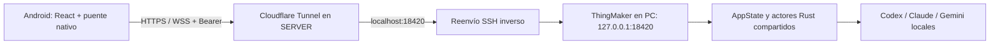

# ThingMaker en Windows y Android

Guía de la adaptación local, actualizada el **3 de octubre de 2026**.
El código original procede de `Pau-mbox/ThingMaker`; los cambios de Windows y
Android están guardados en este repositorio y no se han enviado al upstream.
El historial detallado de implementación y pruebas está en [NOTES.md](../NOTES.md).

## Estado verificado

| Parte | Estado al actualizar esta guía |
| --- | --- |
| Código | `origin/main` hasta `4326772` integrado mediante `038a0fe`; adaptación anterior guardada en `0114be5` |
| Respaldo | Rama `backup/windows-android-before-main-20261003` |
| Windows instalado | Compilación del 2 de octubre, con servidor remoto API v2 |
| Windows actualizado | Compilación e instalador del 3 de octubre terminados; instalación manual pendiente |
| Android publicado | **2.0.1**, `versionCode` **3**, paquete `dev.thingmaker.remote` |
| Acceso remoto | `https://thingmaker.jacksparrot.com`; `/health` respondió API v2 en la comprobación de esta actualización |
| Validación móvil | Emulador Android API 35; no se ha probado todavía en un teléfono físico |
| Proveedores | Respuestas reales de Codex verificadas; turno remoto real de Claude pendiente; Gemini no instalado/validado aquí |

La ejecución automática del último instalador de Windows fue rechazada con el
motivo genérico «bloqueado por política». Compilarlo no equivale a haberlo
instalado. El APK 2.0.1 funciona con el servidor anterior, pero los nuevos datos
`commandActions` de Codex requieren instalar también la compilación nueva del PC.

## Qué se ha hecho

Se adaptó ThingMaker a Windows x64: instalador NSIS por usuario, descubrimiento
de Codex y Claude, ejecución de subprocesos sin ventanas de consola, variables
de entorno de Windows, Credential Manager, pipes locales para delegación y
terminal ConPTY con `cmd.exe /D`. Se corrigió el inicio de la terminal en
`C:\Windows` causado por rutas canónicas con prefijo `\\?\`: ahora se pasa la
ruta local del proyecto. Las carpetas UNC se rechazan en este flujo de terminal.

Android empezó como controlador sencillo en 1.0.0. En 2.0.0 pasó a incluir los
mismos componentes React del escritorio, con conexión bidireccional WebSocket,
barra lateral desplegable, pestañas desplazables y controles táctiles. Se
corrigió también la altura inicial de WebView y su ajuste al teclado.

La versión 2.0.1 integra el cambio de `main` **4326772**: acciones agrupadas en
bloques desplegables, etiquetas de actividad, contador de pasos y detalle de
entrada/salida. El conflicto estaba en `styles.css`; se conservaron los estilos
nuevos y los móviles. Se adaptaron rutas de Windows y controles de 44 px.

## Conectar el móvil

1. Mantén encendidos el PC y ThingMaker. Los agentes se ejecutan en el PC.
2. En los ajustes del escritorio, abre **Control remoto Android** y copia la
   clave generada en ese PC.
3. En JackApps, refresca la lista e instala **ThingMaker Remote 2.0.1**.
4. Abre la app, utiliza `https://thingmaker.jacksparrot.com` y pega la clave.
5. Selecciona un proyecto y abre o reanuda su conversación. Al añadir un
   proyecto por ruta desde Android, introduce una carpeta del **PC**.

[APK publicado 2.0.1-3](https://builds.jacksparrot.com/apps/dev.thingmaker.remote/2.0.1-3.apk).
La descarga usa el acceso habitual de JackApps; la clave remota de ThingMaker
sirve para conectar al PC, no para descargar APKs.

La clave se cifra en Android mediante Keystore y no está incluida en el APK,
en el almacenamiento JavaScript ni en la URL. Android desactiva las copias de
seguridad de estos datos. Al regenerarla en el PC se revocan las conexiones
existentes y debes introducir la nueva clave en el móvil.

## Interfaz compartida y límites

Proyectos, conversaciones, selección de proveedor/modelo, herramientas,
revisión, archivos, terminal, equipos, Big Thing e integraciones usan la misma
interfaz React. Las funciones de archivos y terminal operan sobre el PC.
Android añade confirmaciones, selección de medios y guardado de texto nativos.

El inicio de sesión de proveedores, los editores externos del PC y algunos
diálogos de importación de skills o exportación de múltiples artefactos siguen
requiriendo el escritorio. Desconectar o cerrar Android no cierra ThingMaker.
La ejecución aceptada puede continuar mientras el móvil está sin conexión;
cerrar ThingMaker en el PC detiene los procesos locales según su flujo de salida.

## Arquitectura y reconexión



El transporte Android es OkHttp nativo contra `/v2/ws`. La página se carga
localmente mediante WebViewAssetLoader; solo su origen HTTPS y marco principal
pueden usar el puente. `bridge.ts` elige IPC de Tauri en el escritorio y el
puente nativo en Android. El servidor despacha **163 operaciones tipadas**; las
suscripciones se manejan aparte. No es una API de comandos arbitrarios.

Los eventos de conversaciones, terminal y tareas llegan por WebSocket. Al
reconectar se restauran suscripciones y se reconcilian instantáneas e historial
retenido. No se repiten automáticamente los envíos cuyo resultado sea incierto.
Si el PC se reinicia, las sesiones antiguas vuelven al proyecto para reanudarlas
explícitamente. REST `/v1` sigue disponible para el primer APK.

La clave remota autoriza acciones con los permisos del usuario del PC y debe
tratarse como una credencial de control de ese equipo. Es independiente del
login de los proveedores y de sus suscripciones. Véase
[ADR-011](adr/ADR-011-shared-android-remote-ui.md).

## Operación y recuperación de errores 502

`ThingMakerRemoteForward` ejecuta el trabajador de PowerShell 7 con SSH hacia
`hermes-server`. El túnel está en SERVER y no se abre el puerto del router ni
un listener de la API en la LAN.

El 502 anterior ocurrió porque SSH terminó con código 0 y la política de
reinicio solo cubría fallos. Ahora el trabajador reconecta tras cualquier
salida, espera cinco segundos entre intentos y tiene un supervisor programado
cada minuto, además del inicio de sesión. Las ejecuciones solapadas se ignoran.
Se probó cortando el proceso SSH y comprobando la recuperación de HTTPS.

Para diagnosticar, compara el origen con el acceso público:

```powershell
curl.exe http://127.0.0.1:18420/health
curl.exe https://thingmaker.jacksparrot.com/health
Get-ScheduledTask -TaskName ThingMakerRemoteForward | Select-Object TaskName,State
```

Si ambos fallan, comprueba ThingMaker en el PC. Si el origen funciona y el
público devuelve 502, revisa el reenvío SSH y el túnel en SERVER. Un error 401
de una operación protegida apunta a la clave; `/health` es público y no prueba
que los comandos autenticados funcionen.

## Compilar y actualizar

Desde la raíz del repositorio, Windows necesita Node 24, pnpm 10+, Rust stable,
Visual Studio con C++ y SDK de Windows, además de WebView2.

```powershell
pnpm.cmd install --frozen-lockfile
. .\scripts\windows-build-env.ps1
pnpm.cmd --filter @thingmaker/desktop exec tauri build --config src-tauri/tauri.windows.conf.json --bundles nsis
```

Instalador generado: `target/release/bundle/nsis/ThingMaker_0.0.0_x64-setup.exe`.
Instalación local actual: `D:\apps\ThingMaker\thingmaker-desktop.exe`.
Cierra ThingMaker mediante **Quit and stop local tasks** antes de instalar una
actualización. `pnpm.cmd app` compila e instala usando el directorio recordado
en `target/install-directory.txt`; no debe confundirse con compilar únicamente.
Comprueba si el instalador ya ha abierto ThingMaker antes de lanzar otra instancia.
Un proceso `--thingmaker-mcp` es un relay de delegación y puede coexistir con la app.

Android necesita Java 17 y SDK 36. Desde la raíz, genera primero el renderer
compartido y después el APK:

```powershell
pnpm.cmd --filter @thingmaker/desktop run build:vite
& C:\Users\franc\.local\bin\python3.12.exe scripts/shared-ui-android.py
$env:ANDROID_HOME = 'C:\Users\franc\AppData\Local\Android\Sdk'
Set-Location apps/android
.\gradlew.bat assembleDebug
```

APK: `apps/android/app/build/outputs/apk/debug/app-debug.apk`. Los assets se
generan y no se guardan en Git. Windows y Android pueden producir hashes
distintos del renderer por su objetivo de compilación, aunque compartan fuente.
Si cambian comandos o sus firmas en Tauri, regenera el dispatcher con
`scripts/generate-remote-dispatch.py` antes de compilar y comprueba su diff.

Para JackApps, conserva la clave de firma y aumenta `versionCode` en cada
publicación. En este equipo se utiliza `D:\jackapps\tools\upload_build.py`
con `JACKAPPS_API_URL=https://builds.jacksparrot.com` y la credencial de admin
en el entorno. Haz un `--dry-run`, revisa versión, notas y URL, publica sin
`--force` y verifica el SHA256 del APK almacenado en SERVER.

## Pruebas y evidencias

La integración del 3 de octubre pasó **272 pruebas de interfaz/contratos**,
**3 pruebas del puente Codex**, **4 pruebas nativas de escritorio**, revisión
`clippy` sin advertencias y compilaciones Vite, Android y NSIS.

Contra el servidor instalado y el túnel real se comprobaron rechazo de claves
incorrectas, envíos inválidos/duplicados, respuesta real de Codex, terminal
bidireccional en la carpeta correcta, recuperación del historial y eventos de
estado. El emulador 2.0.1 conservó su login y mostró una acción real de shell en
un bloque plegado/desplegado, con control de 44 px y sin desbordamiento horizontal.
La prueba de pérdida de red sin mensajes duplicados se realizó en 2.0.0.

Los nuevos `commandActions` pasan las pruebas del puente, pero no se han
validado en el PC instalado porque sigue con la compilación anterior. Tampoco
se ha hecho todavía una prueba física en móvil ni un turno remoto real de Claude.

Las pruebas en vivo usan el proveedor y pueden consumir su cuota. Se ejecutan
de forma separada de las pruebas unitarias:

```powershell
pnpm.cmd test
. .\scripts\windows-build-env.ps1
cargo test -p thingmaker-supervisor agents::codex::bridge
cargo test -p thingmaker-desktop
cargo clippy -p thingmaker-desktop --all-targets -- -D warnings
& .\target\ws-verifier\Scripts\python.exe scripts/verify-websocket.py
```

El último comando requiere el entorno local de verificación con
`websocket-client`, el PC en ejecución, la clave local y el proyecto de prueba
`ThingMaker-Remote-Demo`. `scripts/verify-remote.py` prueba REST y revocación;
esta última cambia temporalmente la clave y puede requerir reconectar el móvil.
`scripts/android-ui-probe.py` sirve para inspeccionar el APK de depuración con
ADB y un reenvío local del depurador WebView; ese puerto no se publica.

Las evidencias en `target/` son locales e ignoradas por Git: logs `main-*`,
`websocket-verification.json`, `main-tool-verification.json` y las capturas de
Android. El historial duradero de conclusiones está en `NOTES.md`.

SHA256 del APK 2.0.1 publicado y comprobado en SERVER:

```text
5D1492F074C3CAC0249DA1372C4EC63CA296CEAFD96A78A86C624380A0182297
```
